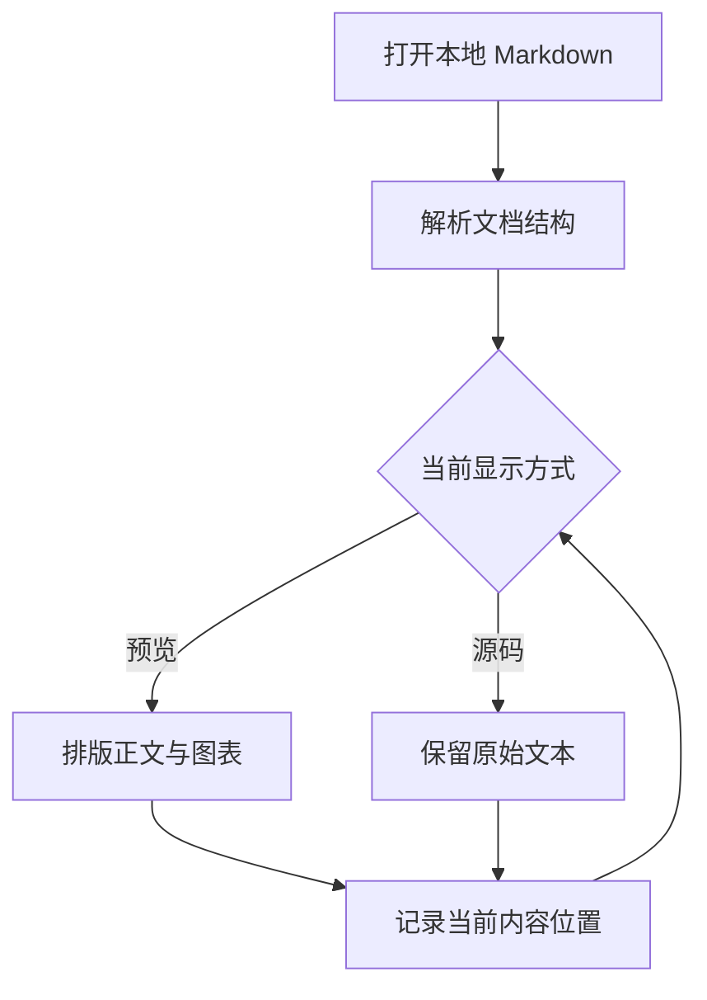
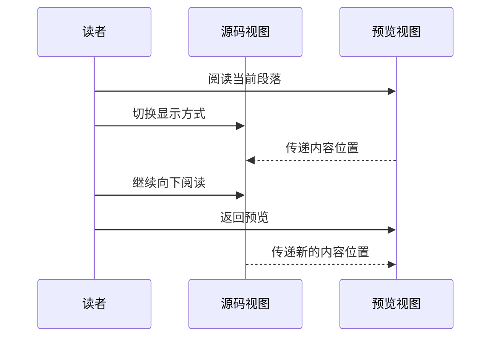
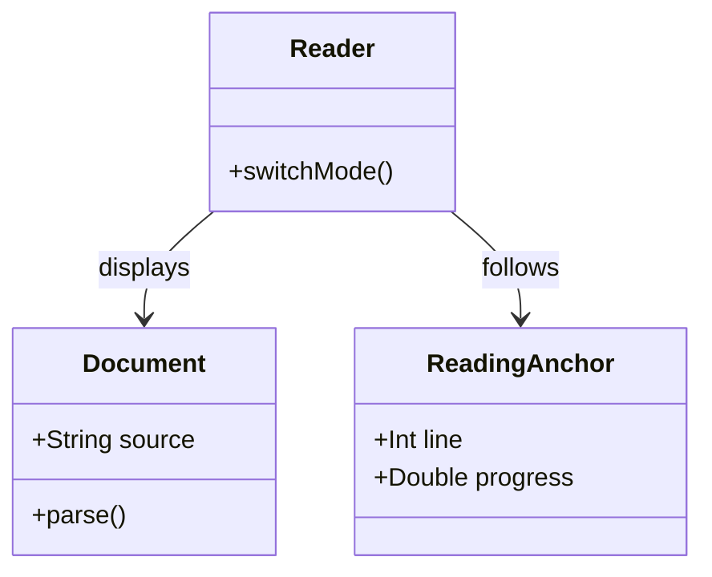
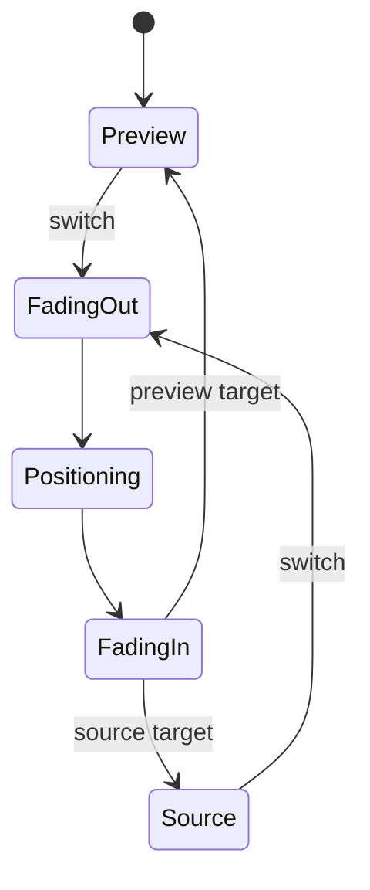
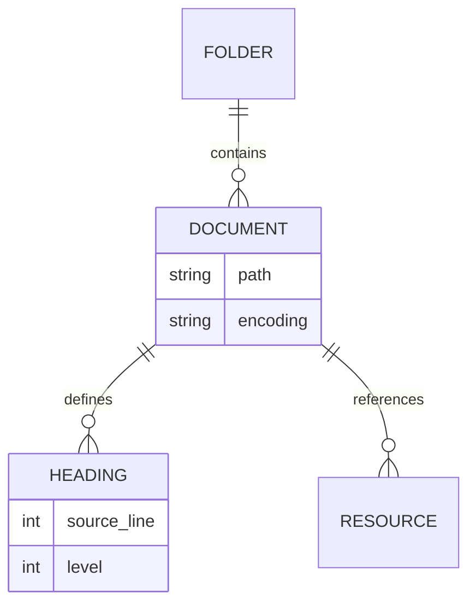

# Markdown 长文阅读与技术笔记

这是一份可以实际滚动、选择、修改和来回切换的长文样例。内容同时包含基础 Markdown、常见扩展和正文 HTML。标题与正文都保存在这份源码里，预览和目录从同一份内容生成。

阅读时可以先通过目录找到中间章节，再切到源码；也可以在源码中继续滚动，然后切回预览。观察对应的段落、表格行或代码行是否仍在眼前，比只在文首切换更容易发现问题。

## 1. 从纯文本到可阅读的文档

### 1.1 文档结构比装饰更重要

Markdown 用少量标记表达结构：标题划分章节，段落承载解释，列表描述并列关系，引用保留外部观点。阅读器的职责是把这些关系呈现清楚，让作者写下的内容成为视觉层次的来源。

一份笔记可以没有封面、摘要卡片或章节编号。作者没有写的内容，不应该在渲染时自动补上。与其给每段文字套上不同的容器，不如把字号、行距、段间距和阅读宽度处理好。

在技术文档里，结构还承担定位作用。读者可能从第三章跳到第七章，复制一段配置，再返回原来的解释。如果标题、源码和预览之间没有稳定关系，每次切换都会打断阅读。

### 1.2 段落、软换行与硬换行

这两行在源码中分开。
默认属于同一个段落，预览时允许合并为自然的行内空白。

这句话末尾有两个空格。  
因此下一句话会从新的一行开始。

这句话使用反斜杠结束。\
它也会产生明确的换行。

下面是独立段落。空行表达段落边界，不应只依靠源码里的普通换行猜测作者是否想另起一段。中英文混排时，还需要观察英文单词、标点和数字是否自然排列，例如 `Markdown 2026`、`iPadOS`、`UTF-8` 和 `第 42 行`。

### 1.3 一段故意写得比较长的说明

阅读位置不是滚动条的百分比。相同的源文件在不同视图里会占用不同高度：一个图片引用在源码中可能只有一行，在预览中却占据半屏；十行表格源码经过排版后可能出现换行和更高的行距；同一段文字在窄屏上也会比宽屏占据更多行。因此，当读者切换显示方式时，应该先确定当前正在看的内容，再在另一种排版中找到它的位置。这段文字故意保持为一个较长的逻辑行，用于观察自动折行之后的段内定位：从中部切到源码，再切回预览，应该仍然留在同一段的相近进度；如果在源码中继续向下滚动，则下一次预览应该跟随新的阅读位置。这个过程不依赖光标，也不要求读者先点击正文。文档里有图片、引用和代码时，原理仍然相同，只是需要采用各自合适的内容边界。最终的体验应当让人感觉是在换一种方式看同一页文字，而不是打开了两份互不相关的文件。

## 2. 行内样式与特殊字符

### 2.1 强调、删除线与代码

普通文字、*斜体强调*、**加粗重点**、***加粗与斜体组合***，以及 ~~已经过时的说法~~ 可以出现在同一个段落里。样式应当表达作者写下的语义，而不是改变段落的位置或插入额外内容。

行内代码示例包括 `document.md`、`images/diagram.svg`、`source.line` 和 `const answer = 42`。代码应使用等宽字体，背景与正文有轻微区别，较长的路径在窄屏上也不能把整个页面撑宽。

需要显示反引号本身时，可以使用双反引号包围，例如 `` `inline code` ``。代码中的 `<tag>`、`*` 和 `_` 保持字面内容，不再作为 Markdown 标记处理。

### 2.2 转义、实体与标点

转义后的标记是普通文字：\*不是斜体\*、\# 不是标题、\[不是链接\]、\_不是强调\_。这些内容在源码中保留反斜杠，在预览中显示其后的字符。

HTML 实体可以表示符号：`&amp;` 对应 &amp;，`&lt;` 对应 &lt;，`&copy;` 对应 &copy;。代码里的实体保持字面文本，正文里的实体按字符解释。

字符样例：中文引号“阅读位置”、英文引号 "source map"、省略号……、长破折号——、括号（示例）、箭头 →、希腊字母 α β γ，以及 emoji 📖 🔧。这些字符不应该造成选区断裂或丢字。

### 2.3 链接的几种写法

这是一个[带说明文字的 CommonMark 链接](https://spec.commonmark.org/)。也可以使用尖括号形式：<https://spec.commonmark.org/>。

普通网址可以直接写作 https://commonmark.org/ ，邮箱样例为 <reader@example.com>。样例不会自动发送邮件或访问链接，只有点击时才处理跳转。

参考式链接把文字与目标分开：[查看 CommonMark 语法说明][commonmark]，以及另一处使用相同目标的[语法参考][commonmark]。目标定义在文档末尾，预览时不应显示定义行本身。

## 3. 标题层级与目录

### 3.1 第三级标题

目录来自文档真实的标题。根级章节对齐，子标题按层级缩进。有子项和没有子项的目录行都应该保留一致的文字起点，折叠箭头只控制目录树，不隐藏正文。

#### 3.1.1 第四级标题

第四级标题适合进一步说明某个具体步骤。跳转后，可以用它验证较深的目录项目是否能定位到正文，而不是始终停在上一级章节。

##### 3.1.1.1 第五级标题

层级继续增加时，目录应保留结构。正文标题也要与普通段落区分，但不需要每加深一级就显著缩小到难以阅读。

###### 3.1.1.1.1 第六级标题

这是第六级标题之后的段落。长目录、深层节点、折叠后的当前项和窄屏宽度，都可以在这一段附近检查。

Setext 二级标题示例
------------------

上方标题使用下划线形式，而不是井号形式。两种写法都需要进入同一份目录；源码视图应当保持作者原来的写法。

### 3.2 一个故意较长的标题：检查目录换行、首行对齐与章节跳转之后的定位结果

长标题不应该把箭头挤到行外。目录文字换行后，箭头应当与首行对齐；点击区域仍属于同一条目录行。正文中的长标题也要自然换行，避免覆盖右侧内容。

## 4. 列表与引用

### 4.1 无序列表与嵌套

- 文档层：保存标题、段落和资源引用。
- 资源层：图片可以放在任意相对目录。
  - `diagram.svg` 表示同目录文件。
  - `assets/diagram.svg` 表示子目录文件。
  - `../figures/diagram.svg` 表示父目录下的另一个子目录。
    - 访问范围取决于用户授予的文件夹。
    - 路径含中文与空格时也要保留其实际含义。
- 展示层：预览负责版式，源码保留原始文本。

下面是列表里的第二种结构，项目之间包含独立段落：

- 第一项先给出一句概括。

  这是第一项的补充段落。它属于同一个列表项目，不应该错误地回到列表之外。

- 第二项包含一段简短代码。

  ```text
  notes/
  ├── guide.md
  └── assets/
      └── diagram.svg
  ```

### 4.2 有序列表与任务列表

1. 打开本地文档。
2. 先通过目录跳到中间位置。
3. 选中一段文字并释放手指或鼠标。
4. 切到源码，继续滚动一段距离。
5. 切回预览，检查是否跟随新的内容位置。

下面是另一份列表，起始编号来自源码：

7. 有序列表也可以从 7 开始。
8. 渲染器应保留起始编号。

- [x] 标题与段落已经包含在样例中。
- [x] 加入长代码、图片和表格。
- [ ] 在真实 iPhone 上检查阅读体验。
- [ ] 在真实 iPad 上检查横竖屏与分屏。

这里的任务列表用于阅读与格式验证。预览中的复选框显示文档状态，修改状态仍以源码内容为准。

### 4.3 引用与嵌套引用

> 理解一段技术说明时，先找出它回答的问题，再判断每个例子与结论之间的关系。
>
> 同一条引用可以包含多个段落，也可以包含 **强调**、`行内代码` 和链接。
>
> > 这是嵌套引用。层级应当可见，文字仍然有足够的阅读宽度。
>
> - 引用内部的列表仍然是列表。
> - 不应丢失缩进或项目标记。

引用之后回到普通正文，颜色、缩进和左侧引用线都应恢复正常。选择跨越引用和正文的文字时，选区与提问入口仍然应该由用户的实际选择决定。

## 5. 表格与横向空间

### 5.1 对齐与行内内容

| 内容类型 | 左对齐说明 | 居中状态 | 右对齐数值 |
| :--- | :--- | :---: | ---: |
| 标题 | 来自源码的层级 | 已包含 | 6 |
| 段落 | 支持 *强调* 和 **重点** | 已包含 | 12 |
| 代码 | 例如 `source.line` | 已包含 | 80 |
| 图片 | 本地相对路径 | 已包含 | 2 |
| 链接 | [CommonMark][commonmark] | 已包含 | 3 |
| 转义竖线 | `a\|b` 与 a\|b | 已包含 | 1 |

表头、单元格与对齐方式都来自源码。右对齐数值不应该被统一改成左对齐，表格也不应该因为窄屏而把整个阅读页面撑宽。

### 5.2 宽表与多行内容

| 检查对象 | 来源 | 源码中的形态 | 预览中的形态 | 对应位置的依据 | 阅读时需要观察的现象 |
| --- | --- | --- | --- | --- | --- |
| 普通段落 | Markdown | 一行或多行文本 | 按阅读宽度自动折行 | 段落与段内进度 | 切换后仍然是当前这段解释 |
| 代码块 | 围栏代码 | 明确的代码行 | 等宽、保留缩进、高亮 | 块内代码行 | 长代码中部切换后不回到第一行 |
| 图片 | 相对路径 | 单行引用 | 实际图片尺寸 | 图片所在引用位置 | 不按整篇滚动百分比猜测位置 |
| 表格 | 管道表格 | 表头与数据行 | 单元格自动排版 | 当前表格行 | 横向空间不足时表格自行滚动 |
| 引用 | 引用标记 | 带前缀的段落 | 左侧标识与段落层次 | 引用内的对应段落 | 嵌套层级与原始内容保持一致 |
| HTML | 正文标签 | 标签与文字 | 文档语义对应的元素 | 对应 HTML 内容块 | 折叠内容的显示状态可以实际检查 |

宽表之后的正文应该回到正常宽度。横向滚动属于表格本身，不应推动悬浮按钮、目录或整页的横向位置。

## 6. 图片、路径与文档资源

### 6.1 Markdown 图片

下面的图来自本地样例文件夹。它展示一个金融主题的关系图，用于检查图片加载、宽度适配以及图片前后的位置同步。


图片只有一行源码，却可能占据多行正文。这是验证内容映射的重要位置：在图片上方、图片中部和图片下方切换时，结果应该与当前引用位置有关，而不是由全文高度比例决定。

### 6.2 HTML 图片与说明

<figure>
  
  <figcaption>同一份本地资源也可以通过 HTML 图片标签引用。</figcaption>
</figure>

资源目录不必叫 `images`。这份样例恰好使用了该目录；真实文件中的 `assets/`、`figures/` 和同目录文件，都属于按文档位置解析的普通相对路径。

### 6.3 网络图片

下面直接通过 HTTPS 引用一张网络图片，用于检查远程图片加载、尺寸适配，以及图片前后的源码／预览位置对应。


图片来自 [MDN 示例资源](https://github.com/mdn/shared-assets/tree/main/images/examples)。这张图片按文档中的网络地址加载，不转换成内嵌图片；前面两张本地图片仍然使用原来的相对路径。

## 7. 代码阅读

### 7.1 不同语言的短代码

```swift
struct ReadingAnchor {
    let sourceLine: Int
    let progress: Double
    let viewportOffset: Double
}
```

```javascript
const resource = new URL("images/diagram.svg", documentURL);
const message = `当前阅读第 ${line + 1} 行`;
console.log({ resource, message });
```

```json
{
  "document": "guide.md",
  "appearance": "system",
  "readingAnchor": {
    "line": 42,
    "progress": 0.5
  }
}
```

```bash
python3 -m http.server 8765 --bind 127.0.0.1
```

### 7.2 长代码：遍历一个本地笔记目录

下面的 Python 示例故意保留完整结构，方便在函数之间、循环中部和异常处理位置来回切换。它是文档内容，阅读器不会执行代码。

```python
from __future__ import annotations

from dataclasses import dataclass
from pathlib import Path
from typing import Iterable
import argparse
import re


@dataclass(frozen=True)
class Heading:
    line: int
    level: int
    title: str


@dataclass(frozen=True)
class Note:
    path: Path
    headings: tuple[Heading, ...]
    size: int


def discover_notes(root: Path) -> Iterable[Path]:
    """Yield Markdown files in a stable order."""
    for path in sorted(root.rglob("*.md")):
        if any(part.startswith(".") for part in path.relative_to(root).parts):
            continue
        if path.is_file():
            yield path


def read_headings(text: str) -> tuple[Heading, ...]:
    headings: list[Heading] = []
    fence_character = ""
    fence_length = 0

    for number, line in enumerate(text.splitlines(), start=1):
        fence = re.match(r"^ {0,3}(`{3,}|~{3,})", line)
        if fence:
            marker = fence.group(1)
            if not fence_character:
                fence_character = marker[0]
                fence_length = len(marker)
            elif marker[0] == fence_character and len(marker) >= fence_length:
                fence_character = ""
                fence_length = 0
            continue

        if fence_character:
            continue

        match = re.match(r"^ {0,3}(#{1,6})\s+(.+?)\s*#*\s*$", line)
        if match:
            headings.append(
                Heading(
                    line=number,
                    level=len(match.group(1)),
                    title=match.group(2),
                )
            )

    return tuple(headings)


def load_note(path: Path) -> Note:
    text = path.read_text(encoding="utf-8")
    return Note(
        path=path,
        headings=read_headings(text),
        size=path.stat().st_size,
    )


def format_note(note: Note, root: Path) -> str:
    relative_path = note.path.relative_to(root)
    rows = [f"{relative_path} ({note.size} bytes)"]

    for heading in note.headings:
        indent = "  " * (heading.level - 1)
        rows.append(f"{indent}- L{heading.line}: {heading.title}")

    return "\n".join(rows)


def main() -> None:
    parser = argparse.ArgumentParser(description="List headings in local notes")
    parser.add_argument("root", type=Path)
    arguments = parser.parse_args()
    root = arguments.root.expanduser().resolve()

    if not root.is_dir():
        parser.error(f"Not a directory: {root}")

    for path in discover_notes(root):
        try:
            note = load_note(path)
        except (OSError, UnicodeError) as error:
            print(f"Skipped {path.name}: {error}")
            continue

        print(format_note(note, root))
        print()


if __name__ == "__main__":
    main()
```

### 7.3 长行、无语言代码与缩进代码

```text
notes/研究资料/一个很长的目录名称/用于检查水平滚动的文档目录/another-long-directory/reading-position-example-with-a-long-file-name.md
```

上面的代码行保持为单行，在代码块内部水平滚动。正文仍然留在原来的水平位置。下面的围栏没有语言标记，应当保留文本内容，不猜测成别的文档结构。

```
# 这里不是文档标题
**这里不是加粗正文**
<details>这里也是字面文本</details>
```

下面是四空格缩进代码，而不是围栏代码：

    config = {
        "encoding": "utf-8",
        "preserve_source": True,
    }

## 8. 正文 HTML

### 8.1 行内语义

使用 <kbd>⌘</kbd> + <kbd>F</kbd> 表示键盘按键。<mark>需要留意的文字</mark>可以标记出来，<small>这是一段补充说明</small>，水的写法可以是 H<sub>2</sub>O，简单平方写作 x<sup>2</sup>。

也可以保留 <abbr title="HyperText Markup Language">HTML</abbr> 缩写、<del>旧文字</del> 和 <ins>修订后的文字</ins>。这些都是正文语义，不需要增加阅读器的工具按钮。

### 8.2 折叠详情

<details>
<summary>展开查看：一段较长的补充说明</summary>
<p>这是折叠详情中的第一段内容。折叠组件来自文档本身，不属于阅读器的目录导航。</p>
<p>展开以后，下面的章节会向下移动。这时可以滚动到后面的正文，再切到源码，检查位置映射是否使用了更新后的布局。</p>
<ul>
<li>保留原文顺序。</li>
<li>允许选择其中的文字。</li>
<li>与普通 Markdown 段落使用同一套正文颜色。</li>
</ul>
</details>

<details open>
<summary>这段详情默认展开</summary>
<p>源码中存在 <code>open</code> 属性，因此初始预览应该显示内部内容。不要为了统一视觉而忽略作者指定的展开状态。</p>
</details>

### 8.3 HTML 表格与合并单元格

<table>
<caption>一组带合并单元格的阅读检查项</caption>
<thead><tr><th>类型</th><th>项目</th><th>说明</th></tr></thead>
<tbody>
<tr><td rowspan="2">位置同步</td><td>源码 → 预览</td><td>以当前可见内容为依据</td></tr>
<tr><td>预览 → 源码</td><td>对应到段落或代码内部行</td></tr>
<tr><td colspan="3">单元格合并来自文档 HTML，不由阅读器猜测。</td></tr>
</tbody>
</table>

### 8.4 HTML 与 Markdown 的边界

HTML 块里的 Markdown 是否继续解析，取决于具体语法规则。下面用真正的 HTML 表达强调，而不依赖在 HTML 块中重新解释星号。

<div>
<p>这是 <strong>HTML 中的加粗</strong> 和 <em>HTML 中的强调</em>。</p>
<p>这是一段带显式换行的文字。<br>第二行仍属于同一个段落。</p>
</div>

源码中的 HTML 注释不会显示在正文里：<!-- 这条注释用于检查源码与预览的差异。 --> 注释之后的文字应当正常显示。

## 9. 脚注与补充材料

脚注适合放置补充解释，让正文保持连贯。这个段落包含第一个脚注引用[^position]，后面还有一条关于文件路径的补充[^paths]。点击引用可以跳到文末说明，再通过返回链接回到引用处。

同一条脚注也可以再次引用[^position]。多个引用指向同一份解释时，编号应保持一致，不应该复制出内容不同的脚注。

下面用分隔线把补充说明与最后的阅读检查分开。

---

## 10. 连续阅读与位置检查

### 10.1 从目录进入文档中部

先展开目录，选择“长代码：遍历一个本地笔记目录”。这个入口距离文首已经很远，适合观察当前章节标识、目录自身滚动和正文跳转之间的关系。

进入该小节后，不必停在标题处。继续滚到 `read_headings` 的循环中部，再切到源码。源码应当对应当前代码内容，而不是只把围栏第一行放在顶部。

接着在源码里向下滚到 `format_note` 附近，再切回预览。这个方向同样需要同步；如果两边只是各自记住上次位置，就会错误地回到之前的循环中部。

### 10.2 往返切换与文档末尾

在相同位置连续切换几次，内容不应逐渐向前或向后漂移。视图切换的淡出与淡入应该围绕当前位置进行，不能先显示文首，再出现一次明显的滚动跳转。

文首、文末和很短的内容块会受到可滚动范围限制。如果目标视图剩余内容不足一屏，允许位置靠近同一段落，而不要求制造大量空白去强行匹配每一个像素。

这一段附近可以检查文末切换。即使无法让最后一句恰好位于屏幕顶部，目标视图也应该包含相应的最后一部分内容，不能回到文章开头。

### 10.3 编辑之后再预览

切到源码后，可以修改这一段文字，或在它上方加入一个新标题。再次进入预览时，正文、目录和位置映射都需要根据当前源码重新生成。

源码修改会保存到当前打开的文档。这个测试副本与仓库里的原始样例相互独立，可以用于检查保存、撤销和重新打开后的内容。

## 11. 数学公式

### 11.1 行内公式与独立公式

行内公式 $E = mc^2$ 可以与文字连续阅读，概率表达式 $P(A \mid B)$ 也不需要单独占据一段。另一种行内写法是 \(a^2 + b^2 = c^2\)。

$$
\frac{1}{n}\sum_{i=1}^{n} x_i = \bar{x}
$$

### 11.2 矩阵、分段函数与多行推导

$$
A = \begin{bmatrix}
1 & 2 & 3 \\
4 & 5 & 6 \\
7 & 8 & 9
\end{bmatrix}
$$

\[
f(x) = \begin{cases}
x^2, & x \ge 0 \\
-x, & x < 0
\end{cases}
\]

$$
\begin{aligned}
\operatorname{Var}(X) &= \mathbb{E}[(X-\mu)^2] \\
&= \mathbb{E}[X^2] - \mu^2
\end{aligned}
$$

公式属于正文，宽度不足时在公式区域内横向滚动。切换到源码后仍然看到作者写下的公式表达式，而不是渲染生成的 HTML。

## 12. Mermaid 图表

### 12.1 流程图



这张图直接来自上面的 Mermaid 代码块。修改节点文字后再次预览，图中的文字也应该更新。图表不会访问在线渲染服务。

### 12.2 时序图



### 12.3 类图



### 12.4 状态图



### 12.5 实体关系图



### 12.6 甘特图


图表较宽时，保留文字与连线的可读尺寸，在图表区域内滚动。流程图、时序图、类图、状态图、实体关系图和甘特图需要分别验证，不把某一种图画出来就当成所有图形都通过。

## 13. 文档末尾

长文阅读最终依赖一系列稳定的小细节：段落间距清晰，代码保留缩进，图片不会丢失，目录随时可用，切换视图仍然看着同一处内容。

到达这里以后，可以回到第五章观察宽表，也可以回到第八章展开详情。不同形态的内容拥有不同高度，足够长的样例才能让这些差异在滚动和切换时显现出来。

最后一段仍然是普通正文。它没有额外的“阅读完成”按钮或自动追加的推荐内容；文档结束的位置由源码决定。

[^position]: 阅读位置在这里指当前可见内容在源文件中的位置，而不是整篇文档的滚动百分比。

[^paths]: 相对路径以当前 Markdown 文件所在目录为基准。文件夹授权与通用资源解析需要在原生实现阶段接入。

[commonmark]: https://spec.commonmark.org/ "CommonMark specification"
