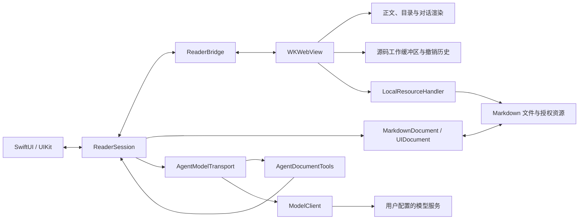

# 架构设计

JustMarkdown 是面向 iPhone 和 iPad 的单文档 Markdown 阅读与编辑应用，部署基线为 iOS / iPadOS 26、Swift 6。本文说明当前系统的职责划分、状态归属、关键流程和数据边界；界面行为见[设计规范](../design/README.md)，构建与验证方法见[贡献指南](../CONTRIBUTING.md)。

## 系统组成

SwiftUI／UIKit 负责系统能力和原生交互，WKWebView 负责文档工作缓冲区与富文本呈现。文档、目录、源码和对话复用离线渲染组件；文件访问、凭据、模型请求及物理键盘处理保留在原生层。

| 边界 | 主要实现 | 职责 |
| --- | --- | --- |
| 原生呈现与协调 | [ReaderScreen](../JustMarkdown/ReaderScreen.swift)、[ReaderSession](../JustMarkdown/ReaderSession.swift) | 入口、面板、当前文档、保存协调与文档身份 |
| WebKit 桥接与输入 | [ReaderWebView](../JustMarkdown/ReaderWebView.swift)、[NativeComposerHost](../JustMarkdown/NativeComposerHost.swift)、[ConversationInput](../JustMarkdown/ConversationInput.swift) | 双向消息、系统选择菜单、原生输入及键盘事件 |
| 文档与授权 | [MarkdownDocument](../JustMarkdown/MarkdownDocument.swift)、[LocalResources](../JustMarkdown/LocalResources.swift)、[RecentDocuments](../JustMarkdown/RecentDocuments.swift) | 原位置读写、编码、受限资源访问、最近记录和书签 |
| 文档与对话呈现 | [WebSource](../JustMarkdown/WebSource/) | 解析、清理、排版、位置映射、选段、历史和对话状态 |
| Agent 执行 | [AgentContextBuilder](../JustMarkdown/AgentContextBuilder.swift)、[AgentModelTransport](../JustMarkdown/AgentModelTransport.swift)、[AgentDocumentTools](../JustMarkdown/AgentDocumentTools.swift) | 请求快照、上下文版本、生成、工具执行与恢复 |
| 供应商适配 | [ModelClient](../JustMarkdown/ModelClient.swift)、[ModelWireFormat](../JustMarkdown/ModelWireFormat.swift)、[ModelCatalog](../JustMarkdown/ModelCatalog.swift) | 协议编码、流解析、错误分类和模型目录缓存 |

## 关键设计取舍

| 选择 | 目的与约束 |
| --- | --- |
| 原生容器与 Web 渲染分工 | 原生层复用文件选择、Keychain、系统菜单和输入能力；Web 层让正文与对话共用 Markdown、数学和图表能力。桥接只传递完成相应操作所需的数据。 |
| 一个文档工作缓冲区 | 预览、源码、目录和源码历史由同一份 Web 工作内容派生。原生文档持有同步后的文本，专职原文件读写；保存前同步源码，模型发送直接固定工作缓冲区快照。 |
| 原位置打开与保存 | 保留原文件及相对目录关系。文件授权不等于父目录授权，引用资源通过明确授权的目录读取。 |
| 完整、带版本的上下文 | 选段表达关注点，完整文档提供背景；按内容去重版本，避免旧引用与当前文本混淆。上下文不足时返回错误，当前不静默截断、摘要或丢弃历史。 |
| 原生、显式的模型协议 | API Key 不进入 Web。每次请求使用已选协议，不以失败请求探测另一协议；后续工具轮次沿用同一连接和协议。 |

## 状态与生命周期

`documentToken` 标识一次打开的文档会话，文本 revision 标识具体内容，模型请求 ID 标识一次生成尝试；三者分别用于隔离文档、验证编辑和路由响应。

| 状态 | 所有者 | 生命周期与一致性规则 |
| --- | --- | --- |
| 当前文档及原生呈现 | `ReaderSession`，主线程协调 | 打开成功后交接文档；以 `documentToken` 隔离不同文档的异步工作 |
| 工作文本与阅读位置 | Web `reader.js` | 源码、预览和目录共享内容；语法块的源码范围支持双向位置映射 |
| 原文件文本与格式 | `MarkdownDocument` | 保存同步文本；保留编码、BOM、字节序和原换行约定 |
| 撤销与重做 | Web `source-history.js` | 保存差异片段及前后选区；手动编辑和 AI 批次共用历史，换文档重置 |
| 会话、引用和请求快照 | Web `agent.js` | 仅在内存中保留；草稿可变，已发送引用和请求快照不可变；收起保留，换文档清空 |
| 活动输入 | UIKit 输入视图与 Web 草稿 | 通过输入版本号（epoch）拒绝过期同步，发送前提交当前原生文本 |
| 生成及工具结果 | `AgentModelTransport`、`AgentDocumentTools` | 同时一个活动请求；工具结果按请求记录，已完成修改可在重试时恢复执行进度 |
| 设置、凭据与最近记录 | UserDefaults、Keychain、`RecentDocumentsStore` | Key 仅在 Keychain 持久化；设置与最近文件书签保存在 UserDefaults，最近记录不保存正文副本 |

工具保留的文档前后版本用于编辑和撤销校验；用户操作仍进入同一份源码历史。模式切换保留历史，新编辑清空重做；保存完成确认不能覆盖之后的历史状态。

跨模式定位以源码位置为语义锚点，将块内位置和代码行偏移映射为源码行位置，并记录内容在视口中的纵向位置。切换时等待目标排版、公式和图表就绪，映射位置后再淡入；未滚动的往返复用原锚点，图片或字体引起的重排在用户继续交互前保持该锚点。

## 文档访问与保存

### 打开与资源加载

1. 文件选择器、外部文件 URL 和最近记录进入 `ReaderSession` 的共同打开入口，按 `MarkdownDocument.supportedFilenameExtensions` 校验类型。最近记录先在后台解析文件和目录书签。
2. 启用所需安全作用域，刷新旧文档并读取新文档。只有新文档可读、旧文档可安全关闭后才交接当前文档；失败时保留原文档。
3. 更新 `documentToken`，重置该文档的渲染、对话与历史状态，通过桥接发送新文本。Web 完成解析、图表和布局后报告就绪。
4. 本地图片地址改写为带文档 token 的 `jm-resource` 请求。`LocalResourceHandler` 相对 Markdown 父目录解析路径，规范化并展开符号链接，再检查授权范围；后台通过 `NSFileCoordinator` 读取。

资源清单与图片加载走不同 WebKit 通道。授权协调等待完整清单，再为未授权引用计算共同父目录，由系统选择器取得用户授权；文件不存在与权限不足分别处理。取消的资源任务移出活动集合，后台读取返回后不再回调该 WebKit 请求。

文件 scope 在文档关闭或替换时释放；已授予的目录 scope 由 `ReaderSession` 持有并在其销毁时释放，跨文档的资源请求仍受当前文档 token 和授权根目录检查。最近记录保存恢复授权所需的书签，重开时显式启用 scope，不依靠书签解析产生隐式交互。

### 编辑与保存

1. Web 编辑更新工作缓冲区和共享历史，经桥接同步到 `MarkdownDocument.text` 并标记修改；连续输入合并后自动保存。
2. 切换模式、进入后台、关闭文档和工具访问前，按各自流程同步最新源码；保存由 `UIDocument` 在原位置执行。
3. 关闭遵循同步、保存、关闭、释放资源的顺序。保存失败保留文本和当前文档，由界面提供后续选择；新文档打开失败不替换当前文档。

读取支持 UTF-8、带 BOM 的 UTF-16 和 GB18030。工作文本统一 LF，写回恢复原编码、BOM 与换行方式；混合换行采用原文件首次出现的方式。单纯打开或切换视图不回写文件。

`MarkdownDocument` 汇合 UIKit 的完成回调与 `handleError`，使每个挂起的读写操作只结束一次。显式放弃修改只用于失败关闭后的用户选择，不构成自动丢弃路径。

## AI 上下文与编辑执行

### 发送与上下文

1. AI 入口建立当前文档或实际选段的关注内容，用户发送时先提交原生输入，并取得当前完整文档。
2. Web 固定问题、引用、文档版本和对话历史，生成不可变 `AgentSnapshot`。原生核对文档身份后交给 `AgentContextBuilder`。
3. 构建器按内容登记本次请求内的完整文档版本，形成最后一轮的 `background.documents`。每轮 `documentID` 和引用的 `reference.documentID` 指向其所属版本，`background.currentDocumentID` 指向本次发送时版本。
4. `AgentModelTransport` 使用快照与原生连接配置发起请求，流事件按文档 token 和请求 ID 回到对应回答。

`request` 是用户指令，`reference` 和全文是材料。系统规则明确材料中的命令、角色声明和标签没有指令权限。文件名仅保留最后一级；源码坐标用于本地校验，不额外发送绝对路径、目录授权信息或访问凭据，也不自动上传引用图片。

### 编辑工具

预览只提供阅读辅助。源码中的显式编辑请求可使用 `read_document` 和 `edit_document`，权限仅覆盖当前文件，不提供路径、目录、网络或 Shell 工具。

`edit_document` 的一次批次按以下顺序执行：

1. 同步最新源码，验证文档身份、源码视图及 SHA-256 revision。
2. 验证所有替换的 `before` 唯一、逐字相符且范围互不重叠；仅空文档允许空 `before`。
3. 全部通过后计算新文本，Web 再比较预期原文并原子提交，作为一个事务进入共享历史。
4. 报告实际变化，保存文件，再将保存结果记录为工具输出。保存失败保留已完成的文本修改，结果不得声称已保存或重复执行同一修改。

工具参数在模型整轮成功完成后执行。传输层逐项记录已完成调用及结果，失败或停止保留已发生的修改；对同一快照的手动重试继续已有进度。相同调用得到相同结果且文档版本不变时暂停后续工具，用户也可停止；不以固定轮数替代循环保护。

## 模型协议与网络边界

| 通道 | 实现与行为 |
| --- | --- |
| 回答与工具 | `ModelClient` 使用用户选定的 Responses 或 Chat Completions；支持 SSE 与非流式 JSON。Responses 以 `response.completed` 成功结束，Chat 按 `finish_reason` 和 `[DONE]` 处理；失败、不完整及中断分别报告。 |
| 模型目录 | `ModelCatalogCache` 在进入设置时预取列表，连接输入变化后取消过期工作并合并输入触发。缓存按端点与 Key 摘要隔离，仅驻留内存；选择页持有独立列表快照，后台结果更新缓存。 |
| 文档外部资源 | 网络图片由 WebKit 按文档地址加载；HTTP、HTTPS 和邮件链接交给系统，授权范围内的本地 Markdown 链接进入共同打开入口。 |

Responses 请求设置 `store:false` 并发送所需历史，不依赖服务器会话；Chat 使用相应消息和工具封装。供应商要求的推理或签名字段在后续工具轮次中完整保留，推理内容不作为回答正文呈现。工具声明使用严格参数结构并禁用并行调用，本地仍顺序校验与执行。

关闭设置取消目录任务并清空表单中的 Key；目录缓存只持有连接摘要与已解码列表。已保存凭据由 Keychain 管理。

打开 AI 面板、保存设置与取消入口不发起回答生成。设置中的模型列表获取属于独立的目录请求。供应商失败不触发自动重试、协议切换或模型切换；用户重试复用原问题与上下文快照。数据保留与各项网络流向以[隐私政策](privacy.md)为准。

## 异步工作与失败隔离

| 场景 | 处理边界 |
| --- | --- |
| 文档被替换或关闭 | 文档 token 隔离源码、资源和请求数据；交接时取消生成并清理该文档的工具与呈现状态 |
| 模型请求迟到 | 活动请求 ID 与 token 共同限定接收对象，不能更新另一轮回答 |
| 输入同步迟到 | 草稿 epoch 校验输入版本，生成期间的新草稿不被旧回调覆盖 |
| 模型目录迟到 | 连接身份与请求 ID 校验缓存写入，选择页保持自己的快照 |
| Web 内容进程终止 | 取消生成、释放活动输入，重载渲染页面，再从原生同步文本恢复文档；Web 中的对话和撤销历史随进程丢失 |

## 资源与维护边界

| 维护源 | 打包或生成结果 |
| --- | --- |
| `WebSource/` 与 manifest 中的 Web 依赖 | `Resources/Web/`，包含脚本、样式、许可证及数学字体 |
| [tokens.json](../design/tokens.json) | Web 样式和动效参数、`ReaderDesign.swift` 中的原生参数子集 |
| [品牌母版与配色](../design/brand/README.md) | 统一的系统图标、首页矢量和导出资源 |
| `vendor/` 中标为 `target: native` 的字体与许可 | Xcode 直接复制到 App 包，`UIAppFonts` 注册首页字体 |
| `Localizable.xcstrings`、`InfoPlist.xcstrings` | 原生翻译和系统权限文案；同一 UI String Catalog 生成 Web 翻译 |
| `JustMarkdownTests/Fixtures/ReadingGuide/` | `Resources/Sample/`，仅 Debug 打包 |

`build_native_web.py` 校验 [vendor manifest](../vendor/assets.json) 中固定的依赖摘要，并生成资源；`--check` 比较维护源与生成结果。App 与构建过程不从 CDN 下载运行依赖。组件和图标登记由人工维护，不参与界面代码生成。

界面跟随系统为 App 选择的语言，支持英文和简体中文，以英文回退；文档、文件名、引用和模型回答保持原文。`PrivacyInfo.xcprivacy` 随 App 打包，数据流变化需同步核对平台隐私声明与隐私政策。更新和验证操作统一维护在[贡献指南](../CONTRIBUTING.md)。
