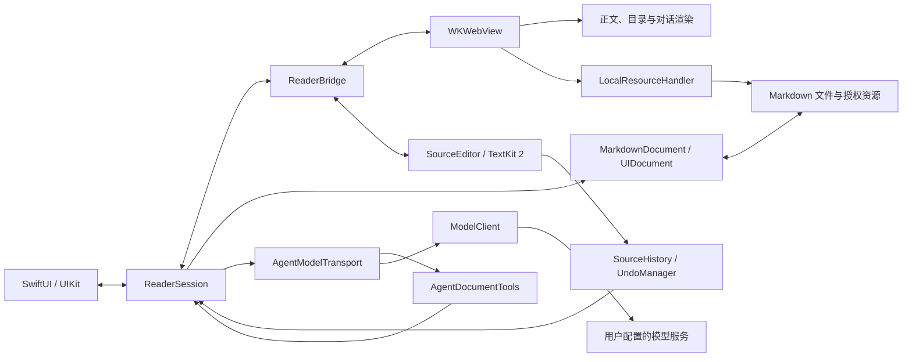

# 架构设计

MarkdownIt 是面向 iPhone 和 iPad 的单文档 Markdown 阅读与编辑应用，部署基线为 iOS / iPadOS 26、Swift 6。本文说明当前系统的职责划分、状态归属、关键流程和数据边界；界面行为见[设计规范](../design/README.md)，构建与验证方法见[贡献指南](../CONTRIBUTING.md)。

## 系统组成

SwiftUI／UIKit 负责系统能力、源码编辑与输入，WKWebView 负责只读文档快照、目录和对话的富文本呈现。源码工作文本与撤销历史由原生层持有，Markdown、数学和图表渲染由离线 Web 组件复用；文件访问、凭据和模型请求保留在原生层。

原生源码位于 `MarkdownIt/`，磁盘目录与 Xcode 分组保持一致。应用入口 `MarkdownItApp.swift` 留在顶层，其余按职责组织；这些目录属于同一个 App target，不形成独立模块。

| 目录 | 职责 |
| --- | --- |
| `Documents/` | 文档读写、资源授权、最近记录及其列表 |
| `Reader/` | 阅读界面、会话协调、视口、WebKit 桥接及共享控件 |
| `Editor/` | 原生源码编辑与撤销历史 |
| `AI/` | 上下文、提示词、图片与编辑工具、模型协议、设置及原生对话输入 |
| `Privacy/` | 原生隐私政策界面 |
| `WebSource/` | 正文、目录与对话的 Web 呈现源文件 |
| `Resources/` | 生成并打包的 Web、隐私政策及 Debug 样例资源 |

| 边界 | 主要实现 | 职责 |
| --- | --- | --- |
| 原生呈现与协调 | [ReaderScreen](../MarkdownIt/Reader/ReaderScreen.swift)、[ReaderSession](../MarkdownIt/Reader/ReaderSession.swift) | 入口、面板、当前文档、保存协调与文档身份 |
| WebKit 桥接与输入 | [ReaderWebView](../MarkdownIt/Reader/ReaderWebView.swift)、[NativeComposerHost](../MarkdownIt/AI/NativeComposerHost.swift)、[ConversationInput](../MarkdownIt/AI/ConversationInput.swift) | 双向消息、系统选择菜单、原生输入及键盘事件 |
| 源码编辑与历史 | [SourceEditor](../MarkdownIt/Editor/SourceEditor.swift)、[SourceHistory](../MarkdownIt/Editor/SourceHistory.swift) | 原生 TextKit 2 输入、工作文本、事务、选区与源码阅读位置 |
| 文档与授权 | [MarkdownDocument](../MarkdownIt/Documents/MarkdownDocument.swift)、[LocalResources](../MarkdownIt/Documents/LocalResources.swift)、[RecentDocuments](../MarkdownIt/Documents/RecentDocuments.swift) | 原位置读写、编码、受限资源访问、最近记录和书签 |
| 文档与对话呈现 | [WebSource](../MarkdownIt/WebSource/) | 解析、清理、排版、预览位置映射、富文本选段和对话状态 |
| Agent 执行 | [AgentPrompt](../MarkdownIt/AI/AgentPrompt.swift)、[AgentContextBuilder](../MarkdownIt/AI/AgentContextBuilder.swift)、[AgentContextMemory](../MarkdownIt/AI/AgentContextMemory.swift)、[AgentContextSources](../MarkdownIt/AI/AgentContextSources.swift)、[AgentModelTransport](../MarkdownIt/AI/AgentModelTransport.swift)、[AgentDocumentTools](../MarkdownIt/AI/AgentDocumentTools.swift)、[AgentImages](../MarkdownIt/AI/AgentImages.swift) | 模式提示词、请求快照、上下文版本、生成、工具执行与恢复 |
| 供应商适配 | [ModelClient](../MarkdownIt/AI/ModelClient.swift)、[ModelWireFormat](../MarkdownIt/AI/ModelWireFormat.swift)、[ModelCatalog](../MarkdownIt/AI/ModelCatalog.swift) | 协议编码、流解析、错误分类和模型目录缓存 |

## 关键设计取舍

| 选择 | 目的与约束 |
| --- | --- |
| 原生容器与 Web 渲染分工 | 原生层复用文件选择、Keychain、系统菜单和输入能力；Web 层让正文与对话共用 Markdown、数学和图表能力。桥接只传递完成相应操作所需的数据。 |
| 一个文档工作缓冲区 | `SourceHistory` 持有工作文本，原生编辑器呈现并提交输入，`MarkdownDocument` 接收修改以保存原文件。Web 只接收按版本串行同步的只读快照；模式切换、AI 入口和发送前等待最新投影，不从 DOM 读取源码。 |
| 原位置打开与保存 | 保留原文件及相对目录关系。文件授权不等于父目录授权，引用资源通过明确授权的目录读取。 |
| 带版本、可按需读取的上下文 | 选段表达关注点，文档提供背景；按内容去重版本，避免旧引用与当前文本混淆。长对话整理为模型工作摘要，超长材料按 ID 读取，界面保留完整历史。 |
| 原生、显式的模型协议 | API Key 不进入 Web。每次请求使用已选协议，不以失败请求探测另一协议；后续工具轮次沿用同一连接和协议。 |

## 状态与生命周期

`documentToken` 标识一次打开的文档会话，文本 revision 标识具体内容，模型请求 ID 标识一次生成尝试；三者分别用于隔离文档、验证编辑和路由响应。

| 状态 | 所有者 | 生命周期与一致性规则 |
| --- | --- | --- |
| 当前文档及原生呈现 | `ReaderSession`，主线程协调 | 打开成功后交接文档；以 `documentToken` 隔离不同文档的异步工作 |
| 工作文本与阅读位置 | 原生 `SourceHistory`、`SourceEditor` 与 Web `reader.js` | 原生拥有工作文本、源码选区与滚动位置；Web 从快照派生预览及目录，以语法块的源码范围映射预览位置 |
| 原文件文本与格式 | `MarkdownDocument` | 保存同步文本；保留编码、BOM、字节序和原换行约定 |
| 撤销与重做 | 原生 `SourceHistory` 与 `SourceUndoManager` | 差异片段及前后选区组成事务，连续输入按语义边界合并；组合输入、粘贴和 AI 批次分别成组。系统菜单、手势、快捷键和触控按钮共用同一个 UndoManager，换文档重置 |
| 会话、引用和请求快照 | Web `agent.js` | 仅在内存中保留；草稿可变，已发送引用和请求快照不可变；收起保留，换文档清空 |
| 活动输入 | UIKit 输入视图与 Web 草稿 | 通过输入版本号（epoch）拒绝过期同步，发送前提交当前原生文本 |
| 生成及工具结果 | `AgentModelTransport`、`AgentDocumentTools` | 同时一个活动请求；工具结果按请求记录，已完成修改可在重试时恢复执行进度 |
| 设置、发送授权、凭据与最近记录 | UserDefaults、`ModelDataConsent`、Keychain、`RecentDocumentsStore` | Key 仅在 Keychain 持久化；设置、已允许服务地址的摘要与最近文件书签保存在 UserDefaults，最近记录不保存正文副本 |

工具保留的文档前后版本用于编辑和撤销校验；用户操作仍进入同一份源码历史。模式切换保留历史，新编辑清空重做；保存完成确认不能覆盖之后的历史状态。

源码使用 `UITextView` 的 TextKit 2 与公开文本位置接口，字体、光标、选择和组合输入沿用 UIKit。`SourceUndoManager` 仅接受文档模型注册的事务，防止 UIKit 的自动注册形成第二份编辑历史；不修改系统光标几何或使用私有文本布局接口。

源码和对话输入视图与 WebView 同属 `ReaderViewport`，不作为 WebView 的子视图，避免原生响应者进入 WebKit 的键盘处理层级。源码输入位于透明 Web 源码区域下方，对话输入位于 Web 上方。桥接将同一布局结果转换到原生宿主坐标，并仅将源码区域的可交互事件交给编辑器；Web 中的对话及遮罩正常合成在源码上方，模态期间原生源码退出触控和辅助功能焦点。

对话输入由 Web 布局胶囊容器、引用和发送按钮，`NativeComposerHost` 按 textarea 的实际区域定位原生文本视图。文本区域在发送按钮前结束，避免透明的原生控件拦截 Web 按钮。等待与接收反馈由 Web 的活动请求状态驱动；正文增量直接进入排版，退场动画不延后内容，也不修改请求历史或草稿。

对话输入的聚焦请求由原生宿主暂存，在收到可见布局或输入视图附着到窗口后处理，不以固定间隔轮询或超时丢弃。收起面板或释放宿主会取消待处理请求，避免迟到布局重新唤起输入。

`ReaderAlert` 在原生提示框关闭完成后执行重试、放弃或打开设置，避免后续操作与上一层提示框的退场重叠。模型设置还等待 Web 面板完成隐藏及模态清理；重新打开面板会取消该次关闭确认，不以固定延时判断转场结束。

对话的滚动跟随状态由 `agent.js` 持有。用户向上浏览时暂停，主动回到末尾后恢复；跟随开启时，内容、视口和滚动位置的变化都保持末尾可见，包括尺寸更新后迟到的滚动事件。布局变化本身不重新开启已暂停的跟随。

Web 快照按 `documentToken` 和原生 revision 串行投递，等待期间合并后续文本更新并保留事务状态事件。保存、工具编辑与历史操作直接读取或提交原生状态，不等待 Web 投影，也不在渲染应答后回写旧文本。AI 编辑的成功以原生事务提交为准，Web 投影失败不将已发生的修改报告为未执行。

跨模式定位以源码位置为语义锚点，将块内位置和代码行偏移映射为源码行位置，并记录内容在视口中的纵向位置。切换时等待目标排版、公式和图表就绪，映射位置后再淡入；未滚动的往返复用原锚点，图片或字体引起的重排在用户继续交互前保持该锚点。

`reader.js` 统一拥有目录与 AI 的布局决策，以共享设计参数计算正文与辅助面板能否同时容纳。显式开关与宽度变化共用互斥规则；只记录用户主动操作的面板，保留隐藏组件的会话与导航状态。呈现方式通过同一组属性交给 CSS 与 `agent.js`，实际侧栏预留宽度和正文列起点经带文档 token 的呈现消息投递给原生悬浮控件，原生层不重复维护断点或目录宽度。宽度重排沿用语义阅读锚点；高度变化不重新选择左右布局。源码宽度变化由 `SourceEditor` 在修改原生 frame 前捕获位置、重排后恢复；Web 布局不向源码回写陈旧锚点。

`ReaderViewport.swift` 集中管理原生视口。`ReaderContainer` 将正文底边直接约束到 UIKit 的键盘布局指引，关闭对未停靠键盘的跟随，并在键盘收起时使用容器底边。停靠键盘缩短内容视口，浮动键盘及实体键盘的局部输入浮条不触发整页底部留白；窗口变化与键盘更新统一由 Auto Layout 处理，不另行计算键盘偏移。`ReaderViewport` 将视口尺寸提交给 Web，SwiftUI 阅读画布延伸至底部。场景进入后台后，系统为快照生成的临时尺寸只影响外层容器，不触发正在阅读的 Web 文档重排；场景激活时按容器的最新尺寸布局。前台旋转与窗口调整正常更新视口，不重载文档或重建会话。

`ReaderFloatingControls` 在原生子控制器中承载两种模式共享的 SwiftUI 操作组，通过独立的 `UIKeyboardLayoutGuide` 跟随浮动输入界面。Auto Layout 只调整操作组的位置，透明定位视图将组外触控交还正文。保留系统已有的布局动画；系统输入浮条在没有动画上下文时更新约束，由定位视图补齐可中断的 UIKit 布局动画，不估算键盘高度或重建输入浮条。子宿主通过 UIKit 继承系统特征，显式传递当前 SwiftUI 动画事务和 Reduce Motion，不整体覆盖子宿主的环境。

`ReaderScreen` 持有一份展开状态，不以窗口宽度或编辑焦点切换操作组形态。`ReaderToolsLayout` 保留各操作的布局槽位及末尾的展开按钮，以可动画的展开进度排列位置；同一模式的布局尺寸不随展开状态变化，末尾按钮保持固定，其他按钮沿各自路径进入或退出，不替换整组布局。展开动画绑定在承载按钮的子宿主内部，使 chevron 旋转、按钮位移和退场共用动画事务与动效参数；外层 UIKit 事务负责原生定位约束。隐藏操作退出辅助功能树，原生定位容器将收起时的触控区域限制在展开按钮内。

`ReaderMoreMenu` 的图标与相邻操作统一由 SwiftUI 绘制，透明的原生 `UIButton` 仅负责菜单交互。`UIMenu` 同步构建并在展示期间保留；协调器单独更新动作回调，避免周围状态更新替换正在操作的菜单项。

## 文档访问与保存

### 打开与资源加载

1. 文件选择器、外部文件 URL 和最近记录进入 `ReaderSession` 的共同打开入口，按 `MarkdownDocument.supportedFilenameExtensions` 校验类型。最近记录先在后台解析文件和目录书签。
2. 启用所需安全作用域，同步并保存旧文档，再读取新文档。同步或保存失败立即中止切换；只有新文档可读、旧文档可安全关闭后才交接当前文档。
3. 更新 `documentToken`，重置该文档的渲染、对话与历史状态，通过桥接发送新文本。Web 完成解析、图表和布局后报告就绪。
4. 本地图片地址改写为带文档 token 的 `jm-resource` 请求。`LocalResourceHandler` 相对 Markdown 父目录解析路径，规范化并展开符号链接，再检查授权范围；后台通过 `NSFileCoordinator` 读取。

资源清单与图片加载走不同 WebKit 通道。授权协调等待完整清单，再为未授权引用计算共同父目录，由系统选择器取得用户授权；文件不存在与权限不足分别处理。取消的资源任务移出活动集合，后台读取返回后不再回调该 WebKit 请求。

文件 scope 在文档关闭或替换时释放；已授予的目录 scope 由 `ReaderSession` 持有并在其销毁时释放，跨文档的资源请求仍受当前文档 token 和授权根目录检查。最近记录保存恢复授权所需的书签，重开时显式启用 scope，不依靠书签解析产生隐式交互。书签恢复失败时，仅应用容器内仍存在的文件可以使用原路径；展开符号链接后的外部路径不能使用此恢复方式。

### 编辑与保存

1. 原生编辑器提交已确认的输入至 `SourceHistory`，同步更新 `MarkdownDocument.text` 并标记修改；连续输入后自动保存。输入法组合中的文本不生成中间事务，显式同步时先提交组合输入。
2. 切换模式、进入后台、关闭文档和工具访问前，按各自流程同步最新源码；保存由 `UIDocument` 在原位置执行。
3. 关闭遵循同步、保存、关闭、释放资源的顺序。保存失败保留文本和当前文档，由界面提供后续选择；新文档打开失败不替换当前文档。

读取支持 UTF-8、带 BOM 的 UTF-16 和 GB18030。工作文本统一 LF，写回恢复原编码、BOM 与换行方式；混合换行采用原文件首次出现的方式。单纯打开或切换视图不回写文件。

`MarkdownDocument` 汇合 UIKit 的完成回调与 `handleError`，使每个挂起的读写操作只结束一次。显式放弃修改只用于失败关闭后的用户选择，不构成自动丢弃路径。

## AI 上下文与编辑执行

### 发送与上下文

1. AI 入口建立当前文档或实际选段的关注内容。用户发送时先提交原生输入，并请求原生层核对该服务的发送授权；允许后才提交对话轮次并取得当前完整文档。取消保留草稿与引用。
2. Web 固定问题、引用、文档版本和对话历史，生成不可变 `AgentSnapshot`。原生核对文档身份后交给 `AgentContextBuilder`。
3. 构建器按内容登记本次请求内的文档快照，统一放入最后一轮的 `background.documents`；每项 `id` 是该版本的标识，`content` 存放内联全文。超出工作预算时改为按 ID 读取。每轮 `documentID` 标记发送时的版本，`reference.documentID` 标记选段所属版本；`background.currentDocumentID` 指定本次发送时的当前版本。版本表只存一份相同正文，旧选段仍可查回所属全文。
4. `AgentModelTransport` 使用快照与原生连接配置发起请求，流事件按文档 token 和请求 ID 回到对应回答。

`request` 是用户指令，`reference` 和全文是材料。系统规则明确材料中的命令、角色声明和标签没有指令权限。文件名仅保留最后一级；源码坐标用于本地校验，不额外发送绝对路径、目录授权信息或访问凭据，选中图片直接附带画面，全局入口提供图片清单并允许模型按需读取。

`AgentPrompt` 先说明当前只读或可编辑的能力，再拼接共享的语言、回答正文、资料与权限规则；任务不限定为预设的几种类型。原生层选择当前能力，不向模型发送内部视图字段；历史视图和引用来源不改变本轮权限。语言兜底取自 `Bundle.main.preferredLocalizations`，在提示词中只给出语言名称，具体优先级见[设计规范](../design/README.md#ai-对话)。回答正文默认使用 Markdown 自由文本，并遵循用户明确指定的其他格式；工具参数使用严格 JSON Schema，并由原生层再次验证，两者不是同一种输出约束。

历史助手消息统一编码为 `answer`、`status`、`sourceChanges`，完整答复也使用相同结构。`answer` 保留原始正文，`failed` 与 `stopped` 保留未完成内容；修改记录统一为数组。历史记录的 JSON 外壳不要求模型在新答复中照样输出。

`ModelDataConsent` 按规范化的服务地址保存授权摘要：折叠协议／主机大小写、默认端口、末尾斜杠和已知 API 后缀，保留不同路径、非默认端口及 HTTP／HTTPS 的区别。授权不绑定模型、API Key 或接口类型。确认结果同时校验原请求、文档 token 和服务地址；切换文档或 Web 进程终止时取消待确认请求。发送和重试在提交前共用授权入口，原生传输边界再次校验，不能通过直接投递快照绕过许可。

### 长对话与超长材料

`AgentContextMemory` 在原生 actor 中管理发给模型的工作上下文，与界面中的完整会话分离。短对话直接发送；接近工作预算时，先把全文和超长引用改为按 ID 读取，再将较早的完整交流整理为摘要，保留近期原始消息及本轮要求。摘要由当前配置的同一模型生成，不带编辑工具，不使用其他服务或供应商专有压缩接口。失败或取消不删除界面内容，也不提交未完成的摘要；已完成摘要按历史前缀校验后复用，旧消息或撤销状态变化会使其失效。

工作预算以 UTF-8 字节、消息与工具开销、图片预留量保守估算，默认上限为 65,536 个估算单位。它是应用的工作集目标，不是精确 token 数，也不代表模型真实容量。模型目录若提供正整数 `context_length` 或 `context_window`，再按其容量的四分之三收紧预算，为生成留出空间；缺失时不根据模型名称猜测。实际服务报告上下文超限后，本轮正常报错，下次用户手动重试使用更小预算，不自动重发失败请求或切换模型。

材料 ID 来自内容摘要，压缩前后保持一致。`background.documents` 中没有 `content` 的条目明确声明通过 `read_document` 读取；超长引用通过 `reference.contentID` 保留精确材料身份。工具只接受当前文件或本轮已登记材料的 ID，支持 UTF-8 字节偏移与文字搜索；返回实际范围、总字节数、是否全文及下一偏移，不把截段标成全文。当前文件的读取同步原生工作文本，历史版本保持不可变。总结全文必须实际覆盖全文；摘要不能充当原文、编辑授权或 revision。

同一轮持续调用工具时，完整调用与结果按对保留；超过预算后仅把已完成的整对交流整理为工具摘要，保留执行日记和编辑防重记录。近期所选及已读图片随相关原始消息保留，较早图片仍可按原 ID 重新取得。文档关闭、替换或渲染进程重置时清空压缩状态；服务、模型、协议或凭据变化隔离摘要缓存。压缩过程使用既有等待和停止反馈，不新增界面上的对话轮数限制。

### 图片上下文

预览中轻点普通图片，由 Web 捕获图片引用并通过文档 token 投递给 `ReaderImageMenu`。UIKit 的 `UIEditMenuInteraction` 由独立的透明、非交互宿主承载，避免在 WebKit 视图上重复注册编辑菜单交互。它呈现“在 AI 对话中引用…”，动作进入已有对话入口；菜单内不读取图片或发送模型请求。滚动、旋转、模式切换及文档交接关闭菜单；已捕获引用按菜单请求身份隔离。图片的长按和右键继续交由 WebKit，带链接图片保留原有跳转，不依赖私有菜单接口。

同一 Markdown 解析与清理流程提取 Markdown、引用式语法和 HTML 图片，代码里的图片样式文本不纳入图片清单。每次引用捕获生成独立图片 ID，当前选段与本轮全文共享同一图片身份。`background.images` 关联图片 ID、文档版本、原引用和替代文本；`currentImageIDs` 与 `reference.imageIDs` 分别标记当前全文及选段的图片。

`AgentImages` 在原生层维护当前文档会话的图片清单和像素快照。选中图片发送前读取；全文只登记引用，由严格参数工具 `read_image(imageID)` 按需读取。工具不接受路径或任意 URL。文件读取复用 `ResourceAccess` 与协调读取，网络下载使用独立无 Cookie、无模型凭据的连接。常规图片经 ImageIO 解码并去除元数据；SVG 在禁止脚本及外部资源的隔离 WebKit 图片页面中栅格化。

已取得的像素按图片 ID 冻结，后续对话与同一请求的重试复用；历史引用通过带文档 token 的 `jm-image` 协议呈现同一画面。关闭或更换文档清空引用与像素。图片读取不授予文档编辑权限，失败返回具体错误，不用替代文本冒充视觉分析。

Responses 用户输入和工具结果均使用图片内容项。Chat 用户输入使用 `image_url` 内容项；其工具结果只允许文字，因此完整保留工具结果及调用 ID 后，以后续用户材料项附带图片。该材料不带 `request`，不改变本轮用户指令或答复语言。所有图片均由原生层封装为数据地址，不要求模型服务读取本地路径。

### 编辑工具

两种模式都可按需使用只读的 `read_document`。源码中的显式编辑请求还可使用 `edit_document`，编辑权限仅覆盖当前文件；两种模式都可按需读取图片清单，但不提供任意路径、目录、网页或 Shell 工具。

`edit_document` 的一次批次按以下顺序执行：

1. 同步最新源码，验证文档身份、源码视图及 SHA-256 revision。
2. 验证所有替换的 `before` 唯一、逐字相符且范围互不重叠；仅空文档允许空 `before`。
3. 全部通过后计算新文本，原生编辑器再比较预期原文并原子提交，作为一个事务进入共享历史，随后更新 Web 快照。
4. 报告实际变化，保存文件，再将保存结果记录为工具输出。保存失败保留已完成的文本修改，结果不得声称已保存或重复执行同一修改。

工具参数在模型整轮成功完成后执行。传输层逐项记录已完成调用及结果，失败或停止保留已发生的修改；对同一快照的手动重试继续已有进度。相同调用得到相同结果且文档版本不变时暂停后续工具，用户也可停止；不以固定轮数替代循环保护。

## 模型协议与网络边界

| 通道 | 实现与行为 |
| --- | --- |
| 回答与工具 | `ModelClient` 使用用户选定的 Responses 或 Chat Completions；支持 SSE 与非流式 JSON。Responses 以 `response.completed` 成功结束，Chat 按 `finish_reason` 和 `[DONE]` 处理；失败、不完整及中断分别报告。 |
| 模型目录 | `ModelCatalogCache` 在进入设置时预取列表，连接输入变化后取消过期工作并合并输入触发。缓存按端点与 Key 摘要隔离，仅驻留内存；选择页持有独立列表快照，后台结果更新缓存。 |
| 文档外部资源 | 网络图片由 WebKit 按文档地址加载；HTTP、HTTPS 和邮件链接交给系统，授权范围内的本地 Markdown 链接进入共同打开入口。 |

Responses 请求设置 `store:false` 并发送所需历史，不依赖服务器会话；Chat 使用相应消息和工具封装。供应商要求的推理或签名字段在后续工具轮次中完整保留，推理内容不作为回答正文呈现。工具声明使用严格参数结构并禁用并行调用，本地仍顺序校验与执行。

回答与模型目录请求共用原生重定向策略，不自动跟随 HTTP 重定向，服务变更通过用户配置 Base URL 完成。关闭设置取消目录任务并清空表单中的 Key；目录缓存只持有连接摘要与已解码列表。已保存凭据由 Keychain 管理。

打开 AI 面板、保存设置与取消入口不发起回答生成。设置中的模型列表获取属于独立的目录请求。供应商失败不触发自动重试、协议切换或模型切换；用户重试复用原问题与上下文快照。数据保留与各项网络流向以[隐私政策](privacy.md)为准。

## 异步工作与失败隔离

| 场景 | 处理边界 |
| --- | --- |
| 文档被替换或关闭 | 文档 token 隔离源码、资源和请求数据；交接时取消生成并清理该文档的工具与呈现状态 |
| 模型请求迟到 | 活动请求 ID 与 token 共同限定接收对象，不能更新另一轮回答 |
| 输入同步迟到 | 草稿 epoch 校验输入版本，生成期间的新草稿不被旧回调覆盖 |
| 模型目录迟到 | 连接身份与请求 ID 校验缓存写入，选择页保持自己的快照 |
| Web 内容进程终止 | 取消生成、释放活动输入，重载渲染页面，再从原生工作文本恢复文档；原生源码历史保留，Web 中的对话随进程丢失 |

## 资源与维护边界

| 维护源 | 打包或生成结果 |
| --- | --- |
| `WebSource/` 与 manifest 中的 Web 依赖 | `Resources/Web/`，包含脚本、样式、许可证及数学字体 |
| [tokens.json](../design/tokens.json) | Web 样式和动效参数、`Reader/ReaderDesign.swift` 中的原生参数子集 |
| [品牌母版与配色](../design/brand/README.md) | 统一的系统图标、首页矢量和导出资源 |
| `vendor/` 中标为 `target: native` 的字体与许可 | Xcode 直接复制到 App 包，`UIAppFonts` 注册首页字体 |
| `Localizable.xcstrings`、`InfoPlist.xcstrings` | 原生翻译和系统权限文案；同一 UI String Catalog 生成 Web 翻译 |
| [隐私政策](privacy.md) | 构建时复用固定 Markdown 解析器生成 `Resources/Privacy` 中英文结构化内容；SwiftUI 原生文本、列表、表格与滚动容器排版，运行时不使用 WebView 或 Markdown 引擎 |
| `MarkdownItTests/Fixtures/ReadingGuide/` | `Resources/Sample/`，仅 Debug 打包 |

`build_native_web.py` 校验 [vendor manifest](../vendor/assets.json) 中固定的依赖摘要，并生成资源；`--check` 比较维护源与生成结果。App 与构建过程不从 CDN 下载运行依赖。组件和图标登记由人工维护，不参与界面代码生成。

界面跟随系统为 App 选择的语言，支持英文和简体中文，以英文回退；文档、文件名、引用和模型回答保持原文。`PrivacyInfo.xcprivacy` 随 App 打包，数据流变化需同步核对平台隐私声明与隐私政策。更新和验证操作统一维护在[贡献指南](../CONTRIBUTING.md)。
