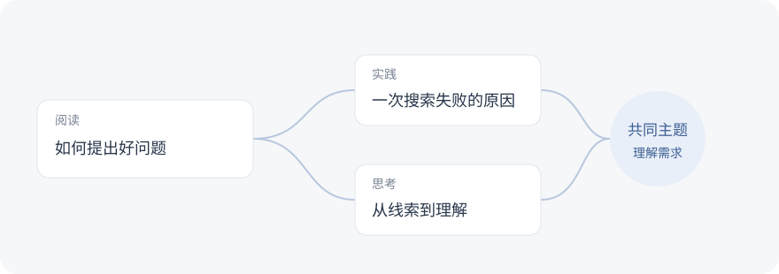

# 给笔记加一个搜索入口

文件夹能把笔记收好，搜索则帮助我们重新找到它们。最近整理阅读笔记时，我想做一个小工具：输入几个还记得的词，就能找回相关的文章、摘录和项目记录。

> 先让一条模糊的线索，通向一份值得重读的笔记。

## 从文件到搜索结果

第一版直接读取本地 Markdown 文件，提取标题、标签和正文。文件变化时更新索引，查询时再计算相关性。


## 让重要的词排在前面

同一个词出现在标题里，通常比出现在长篇正文里更能说明主题。先用一套容易解释的权重，让排序规则保持清楚。

| 匹配位置 | 权重 | 一个例子 |
| --- | ---: | --- |
| 标题 | 3 | 《如何提出一个好问题》 |
| 标签 | 2 | `阅读`、`思考` |
| 正文 | 1 | 段落中的“问题” |

记三个位置的命中数分别为 $h_t$、$h_g$、$h_b$，初始评分可以写成：

$$
S(q,d)=3h_t+2h_g+h_b
$$

### 用代码保留这个想法

先把查询当成完整的关键词，确认权重是否符合直觉。

```python
def relevance(note, query):
    keyword = query.strip().casefold()
    if not keyword:
        return 0
    title = note["title"].casefold()
    tags = " ".join(note["tags"]).casefold()
    body = note["body"].casefold()
    return (
        3 * title.count(keyword)
        + 2 * tags.count(keyword)
        + body.count(keyword)
    )
```

这段规则刻意保持简单。阅读结果列表时，我应该能解释为什么某篇笔记排得更靠前；如果解释不清楚，就先回到规则本身。

## 把笔记之间的联系也留下来

有些内容并不共享相同的词，却在回答同一个问题。比如“如何提出好问题”与“一次搜索失败的原因”，都可能与理解需求有关。



这些链接可以先保留在正文里。等全文搜索足够可靠，再考虑沿着链接找一找相邻的想法。

### 目录只是其中一条路径

笔记依然按熟悉的方式保存，不需要为了建立索引重新整理文件夹。

```text
notes/
├── 阅读/
│   └── 如何提出好问题.md
├── 项目/
│   └── 一次搜索失败的原因.md
└── 思考/
    └── 从线索到理解.md
```

### 保留原始材料

摘录与自己的解释分开写。遇到需要反复阅读的段落，留下引用和出处；产生新的理解时，再在下面补充一段自己的话。[^context]

## 处理真实使用里的小问题

### 空查询与重复结果

没有输入关键词时，不展示无意义的匹配。多个匹配位置落在同一篇笔记里时，合并成一个结果，并保留最能解释相关性的片段。

### 中文、英文与大小写

`Markdown` 与 `markdown` 应当走同一条查询路径。中文先支持连续词组，避免过早引入复杂的分词规则；搜索记录能帮助判断哪些情况值得进一步处理。

### 文件修改与移动

保存笔记后更新对应记录，删除文件时移除索引。遇到移动或重命名，先重新扫描受影响的目录，优先保证结果仍然指向存在的文件。

## 下一步

- [x] 写清楚标题、标签和正文的权重。
- [x] 整理一组包含不同主题的笔记。
- [ ] 选几个日常问题，逐条检查排序是否符合预期。
- [ ] 给结果补上前后文，减少来回打开文件的次数。
- [ ] 尝试把笔记之间的链接纳入候选结果。

<details>
<summary>暂时搁置的想法</summary>

<p>语义搜索和自动分类可以稍后再考虑。先让普通的关键词查询足够可信，也给自己留出观察真实使用习惯的时间。</p>

</details>

[^context]: 一段摘录的意思可能依赖前后的论证。保留足够的上下文，日后回看时更容易判断自己有没有误解。
